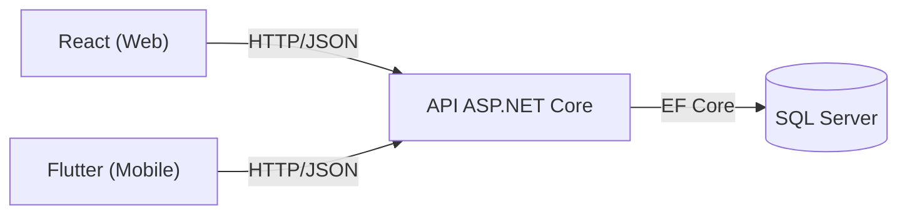

# Sistema de Manutenção Industrial — Backend e Banco de Dados

**API REST | ASP.NET Core 8 + Entity Framework Core 8.0.11 + SQL Server**

Sistema de gestão de manutenção industrial (CMMS) desenvolvido como Projeto Integrado Multidisciplinar (PIM). O backend centraliza autenticação, regras de negócio e o acesso aos dados de equipamentos, ocorrências, ordens de serviço, manutenções corretivas e planos preventivos.

As aplicações web (React) e mobile (Flutter), desenvolvidas pelos demais integrantes da equipe, consomem os endpoints HTTP desta API. Nenhum cliente acessa o SQL Server diretamente.

Este repositório entrega o **Backend e o Banco de Dados do PIM**: código-fonte, migrations, modelo físico, testes e documentação de integração.

O modelo físico aprovado pelo grupo vale como banco oficial do projeto (`SistemaManutencaoPIM`). Alterações de esquema passam a ser feitas apenas por migrations deste repositório, nunca por edição direta no banco.

## Principais funcionalidades

- **Autenticação e autorização:** login JWT e controle de acesso por perfil.
- **Gestão administrativa:** cadastro e consulta de usuários, setores e equipamentos.
- **Ocorrências:** registro, acompanhamento e filtros por equipamento, descrição e status.
- **Ordens de serviço:** criação, atribuição, início, atendimento, conclusão e cancelamento.
- **Manutenção industrial:** registro de diagnóstico, serviço realizado, observações e datas.
- **Manutenção preventiva:** gerenciamento de planos e criação manual de ordens de serviço.
- **Dashboard:** consulta de indicadores administrativos.
- **Integridade:** validações de negócio, controle de estados e proteção contra atribuição simultânea da mesma OS.

A referência completa de endpoints está disponível em [Contratos da API](docs/CONTRATOS_API.md).

## Arquitetura e tecnologias

| Tecnologia | Utilização |
|---|---|
| C# / ASP.NET Core 8 | Desenvolvimento da API REST |
| Entity Framework Core 8.0.11 | Persistência, relacionamentos e migrations |
| SQL Server | Banco de dados relacional (LocalDB em desenvolvimento) |
| JWT Bearer | Autenticação e autorização |
| Swagger / OpenAPI | Documentação dos endpoints |
| Postman | Demonstração dos fluxos HTTP |
| xUnit / WebApplicationFactory / SQLite | Testes automatizados de API |
| xUnit / SQL Server real | Testes de integração da CHECK de tipo de origem |

A API mantém as regras de negócio nos serviços, enquanto os controllers recebem as requisições HTTP e os DTOs definem os contratos de entrada e saída.



Os clientes não acessam o banco diretamente. Toda comunicação com os dados passa pela API.

## Modelo de dados

O esquema físico definido neste repositório:

- **7 tabelas:** `Usuarios`, `Setores`, `Equipamentos`, `Ocorrencias`, `OrdensServicos`, `Manutencoes` e `PlanosManutencao`.
- **8 chaves estrangeiras**, todas com exclusão `Restrict` (nenhuma exclusão em cascata).
- **6 índices únicos**, sendo 3 filtrados (parciais).
- **CHECK `CK_OrdensServicos_TipoOrigem`:** ordem corretiva exige `OcorrenciaId` e não pode ter `PlanoManutencaoId`; ordem preventiva exige `PlanoManutencaoId` e não pode ter `OcorrenciaId`.

Em relação ao modelo do DOCX da disciplina, o grupo aprovou as extensões abaixo, todas registradas no dicionário de dados:

- `OrdemServico.OcorrenciaId` nullable, para permitir ordens preventivas sem ocorrência.
- `OrdemServico.PlanoManutencaoId`, que registra a origem preventiva da ordem.
- `Manutencao.ProblemaResolvido`, resultado informado pelo técnico na conclusão.
- `TempoExecucao` não é persistido: é calculado como `DataConclusao - DataInicio`.

Documentação do banco:

- [DER e modelo físico](docs/DER_MODELO_FISICO.md): diagrama, tabelas, chaves e índices.
- [Dicionário de dados](docs/DICIONARIO_DADOS.md): colunas, tipos, nulabilidade e domínios.
- [Guia de banco de dados](docs/GUIA_BANCO_INTEGRACAO.md): configuração, migrations, backup e handoff.

## Regras de negócio

### Fluxo de uma manutenção corretiva

1. **Operador:** registra uma ocorrência para um equipamento.
2. **Administrador:** cria uma ordem de serviço vinculada à ocorrência.
3. **Técnico:** assume a OS, inicia o atendimento e registra a manutenção.
4. **Técnico:** solicita a conclusão, informando se o problema foi resolvido.
5. **API:** conclui a OS e atualiza os estados da ocorrência e do equipamento conforme o resultado.

| Evento | Comportamento da API |
|---|---|
| Ocorrência registrada | Equipamento passa para `Parado` |
| Manutenção iniciada | OS passa para `EmAtendimento` e equipamento para `EmManutencao` |
| Problema resolvido | OS `Concluida`, ocorrência `Resolvida` e equipamento `Funcionando` |
| Problema não resolvido | OS `Concluida`, ocorrência `Aberta` e equipamento `Parado` |

Outras regras implementadas:

- Um equipamento pode ter apenas uma ocorrência ativa por vez.
- Cada ocorrência corretiva pode estar vinculada a uma única OS.
- Uma OS preventiva pode ser criada a partir de um plano, sem ocorrência corretiva.
- Somente o técnico responsável pode iniciar, registrar e concluir uma manutenção.
- Dois técnicos não conseguem assumir simultaneamente a mesma OS.
- Um plano com OS vinculada não pode ser transferido para outro equipamento.
- Datas de início e conclusão aceitam valores UTC com sufixo `Z`. Quando omitidas, a API utiliza o horário UTC do servidor.

### Perfis e permissões

| Funcionalidade | Administrador | Operador | Técnico |
|---|:---:|:---:|:---:|
| Consultar equipamentos e setores | Sim | Sim | Sim |
| Registrar e consultar ocorrências | Sim | Sim | Não |
| Consultar ordens de serviço | Sim | Não | Sim |
| Assumir e executar manutenção | Não | Não | Sim |
| Criar e cancelar ordens de serviço | Sim | Não | Não |
| Gerenciar usuários, setores, equipamentos e planos | Sim | Não | Não |
| Consultar dashboard | Sim | Não | Não |

A API atualmente permite que Administradores e Operadores registrem ocorrências. Essa permissão adicional do Administrador ainda depende de ratificação do grupo (D11).

As decisões sobre a continuidade de manutenções não resolvidas (D1 e D2) também permanecem documentadas em [Pendências e decisões](docs/PENDENCIAS_E_DECISOES.md).

## Instalação e execução

### Pré-requisitos

- [.NET 8 SDK](https://dotnet.microsoft.com/download/dotnet/8.0).
- SQL Server LocalDB, Express ou Developer.
- Acesso à internet para restaurar os pacotes NuGet.

Para gerenciar migrations manualmente, instale a ferramenta do Entity Framework Core:

```powershell
dotnet tool install --global dotnet-ef --version 8.0.11
```

### 1. Restaurar e compilar

No terminal, abra a pasta principal do repositório, onde está o arquivo `SistemaManutencaoPIM.sln`:

```powershell
dotnet restore
dotnet build
```

### 2. Aplicar as migrations (caminho controlado)

Duas migrations compõem o esquema atual:

| Migration | Conteúdo | Situação no banco oficial |
|---|---|---|
| `20261020021711_InitialCreate` | Criação das 7 tabelas, 8 FKs, índices e constraints | Aplicada |
| `20261023061811_OrdemServicoTipoOrigemCheck` | CHECK `CK_OrdensServicos_TipoOrigem` | Pendente de autorização |

Para aplicar de forma controlada, com o banco alvo definido pela connection string:

```powershell
dotnet ef database update --project SistemaManutencao.API
```

A segunda migration só deve ser aplicada no banco oficial após a auditoria prévia e a autorização do grupo, conforme o procedimento de [Guia de banco de dados, seção 8.3](docs/GUIA_BANCO_INTEGRACAO.md).

### 3. Iniciar a API

No Windows, utilizando PowerShell:

```powershell
Set-ExecutionPolicy -Scope Process -ExecutionPolicy Bypass
.\scripts\iniciar-dev.ps1
```

O script configura o ambiente de desenvolvimento e utiliza `admin@pim.local` como e-mail padrão do administrador inicial.

Se `SeedAdmin__Senha` não estiver configurada, solicita uma senha. O seed é idempotente (`Data/DbInitializer.cs`): o administrador só é cadastrado quando a tabela `Usuarios` está vazia.

Se `Jwt__Key` não estiver definida, o script gera uma chave aleatória para a execução. Tokens gerados anteriormente deixam de funcionar quando a API é reiniciada com uma chave diferente.

Atenção ao flag automático de migrations em Development. Com `Database:ApplyMigrationsOnStartup = true` (configuração atual de `appsettings.Development.json`), qualquer boot da API aplica todas as migrations pendentes no banco apontado pela connection string (`Program.cs:117-127`), incluindo a CHECK ainda não autorizada. Para iniciar sem aplicar migrations:

```powershell
$env:Database__ApplyMigrationsOnStartup = "false"
```

Esse fluxo está detalhado em [Guia de banco de dados, seção 2.2](docs/GUIA_BANCO_INTEGRACAO.md).

Por padrão, o Swagger fica disponível em:

**http://localhost:5088/swagger**

Se não utilizar LocalDB, configure `ConnectionStrings__DefaultConnection` para um banco de desenvolvimento.

Não utilize o banco compartilhado do grupo sem alinhar previamente a estrutura com o responsável pelo SQL Server.

## Autenticação JWT

O login é feito pelo endpoint:

`POST /api/auth/login`

Exemplo de requisição:

```json
{
  "email": "admin@pim.local",
  "senha": "SENHA_DEFINIDA_NA_INICIALIZACAO"
}
```

A resposta contém o token JWT, o tipo `Bearer`, a expiração em UTC e os dados do usuário autenticado.

Nas rotas protegidas, utilize:

```http
Authorization: Bearer ***
```

Para consultar os dados do usuário logado:

```http
GET /api/auth/me
Authorization: Bearer ***
```

As permissões são verificadas pela API. O acesso pode ser negado quando o token está ausente, expirado, inválido ou quando o usuário não possui a autorização necessária.

Não publique tokens, senhas ou chaves em arquivos versionados.

## Testando pelo Swagger

Com a API e o banco de desenvolvimento em execução, é possível demonstrar o fluxo corretivo:

1. Faça login como Administrador em `/api/auth/login` e configure o token no botão **Authorize**.
2. Cadastre um setor, um equipamento, um Operador e um Técnico.
3. Entre como Operador e registre uma ocorrência em `POST /api/ocorrencias`.
4. Entre como Administrador e crie uma OS corretiva em `POST /api/ordens-servico`.
5. Entre como Técnico e utilize as ações `assumir` e `iniciar` da OS.
6. Registre diagnóstico e serviço realizado em `PUT /api/ordens-servico/{id}/manutencao`, ou informe esses textos diretamente na conclusão.
7. Conclua a OS em `POST /api/ordens-servico/{id}/concluir`, informando `problemaResolvido`.
8. Consulte novamente a OS, a ocorrência e o equipamento para conferir os estados atualizados.

Os campos `prioridade`, `tipoManutencao` e `perfil` são obrigatórios nos respectivos contratos.

Utilize os IDs reais retornados pela API. Os exemplos da documentação são apenas ilustrativos.

Uma coleção Postman com **21 requisições organizadas em sequência** também está disponível:

[Coleção Postman](docs/SistemaManutencaoPIM.postman_collection.json)

## Contratos e respostas de erro

Os clientes React e Flutter devem seguir os contratos publicados em [docs/CONTRATOS_API.md](docs/CONTRATOS_API.md).

Pontos importantes para integração:

- As respostas utilizam JSON com propriedades em `camelCase`.
- Os enums são representados como texto.
- Datas de manutenção devem ser enviadas em UTC, com sufixo `Z`.
- `dataInicio` e `dataConclusao` são opcionais.
- A data de conclusão não pode ser anterior ao início da manutenção.
- Diagnóstico e serviço realizado podem ser registrados durante o atendimento ou informados na conclusão.
- Observações anteriormente registradas são preservadas quando omitidas na conclusão.

### Status HTTP

| Status | Significado |
|---|---|
| `400` | Dados inválidos ou requisitos da operação não atendidos |
| `401` | Falha de autenticação |
| `403` | Usuário sem permissão |
| `404` | Recurso não encontrado |
| `409` | Conflito com o estado ou regras de negócio |
| `500` | Erro interno inesperado |

Erros de negócio e de autenticação/autorização utilizam o formato:

```json
{
  "erro": "Mensagem descritiva"
}
```

Erros automáticos de validação de modelo utilizam `ValidationProblemDetails`, com os detalhes no campo `errors`.

Os clientes devem tratar os dois formatos.

### CORS

No ambiente Development, estão configuradas as origens:

- `http://localhost:3000`
- `http://localhost:5173`
- `http://localhost:8080`

Em outros ambientes, configure `Cors:Origens` conforme os endereços utilizados pelo frontend. Sem origens configuradas, nenhuma origem de navegador é liberada por essa política.

## Testes e validação

A suíte tem **114 casos de teste, todos aprovados na última execução (114/114, 0 falhas, 0 ignorados)**, em duas camadas:

| Camada | Casos | Recursos |
|---|---|---|
| API e regras de negócio | 106 | xUnit, `WebApplicationFactory` e SQLite em memória |
| Integração com SQL Server real | 8 | Classe `SqlServerTipoOrigemCheckTests`, trait `Categoria=SqlServer` |

Os 8 testes de SQL Server exercitam a CHECK `CK_OrdensServicos_TipoOrigem` em um banco descartável (`SistemaManutencaoPIM_ValidationTemp`), criado e removido pelos próprios testes.

### Como rodar

Suíte completa, que exige LocalDB disponível na máquina:

```powershell
dotnet test
```

Somente a camada SQLite/API, para máquinas sem SQL Server LocalDB:

```powershell
dotnet test --filter "Categoria!=SqlServer"
```

Atenção: sem LocalDB, esses 8 testes de SQL Server falham. Eles não são ignorados e nunca são marcados como aprovados — a falha é real e significa apenas que a validação contra o SQL Server não pôde rodar naquela máquina. Nesse cenário, utilize o filtro acima para executar os 106 casos de API.

## Status de entrega

### 1. Concluído e validado

- API completa: autenticação JWT, regras de negócio, contratos HTTP, Swagger e coleção Postman.
- Modelo físico fechado e aprovado como banco oficial: 7 tabelas, 8 FKs `Restrict`, 6 índices únicos e a CHECK de tipo de origem.
- Migration `20261020021711_InitialCreate` aplicada no banco oficial `SistemaManutencaoPIM`.
- 114/114 testes aprovados (106 SQLite/API e 8 contra SQL Server real).
- Documentação de banco publicada: DER, dicionário de dados e guia de banco de dados.

### 2. Pendente de autorização

- A migration `20261023061811_OrdemServicoTipoOrigemCheck` ainda não foi aplicada no banco oficial.
- A aplicação depende de auditoria prévia do banco e de decisão do grupo, conforme o procedimento de [Guia de banco de dados, seção 8.3](docs/GUIA_BANCO_INTEGRACAO.md).
- Até lá, iniciar a API em Development com `Database:ApplyMigrationsOnStartup = "false"` (comando na seção de execução).

### 3. Integrações futuras

- Aplicar e validar a migration pendente no SQL Server definitivo do grupo.
- Decidir e implementar as pendências D1 (continuidade da corretiva), D2 (preventiva não resolvida) e D11 (ocorrência pelo Administrador), documentadas em [Pendências e decisões](docs/PENDENCIAS_E_DECISOES.md).
- Consumo efetivo pelos frontends React e Flutter, seguindo os contratos de [docs/CONTRATOS_API.md](docs/CONTRATOS_API.md) e [docs/openapi.json](docs/openapi.json).
- Publicação e deploy do backend.

## Segurança

- O repositório não contém credenciais. Connection string, chave JWT (`Jwt:Key`) e credenciais do seed (`SeedAdmin:Email` e `SeedAdmin:Senha`) são fornecidas por configuração, em variáveis de ambiente ou user-secrets.
- A autenticação usa JWT Bearer com expiração de token, e as permissões são verificadas por perfil em cada rota.

## Estrutura do repositório

```text
SistemaManutencaoPIM/
├── SistemaManutencaoPIM.sln
├── SistemaManutencao.API/
│   ├── Controllers/
│   ├── Services/
│   ├── Models/
│   ├── DTOs/
│   ├── Data/
│   ├── Enums/
│   ├── Helpers/
│   ├── Migrations/
│   └── Program.cs
├── tests/
│   └── SistemaManutencao.Tests/
├── docs/
└── scripts/
    └── iniciar-dev.ps1
```

## Documentação

- [Contratos da API](docs/CONTRATOS_API.md): endpoints, permissões e exemplos JSON.
- [OpenAPI](docs/openapi.json): especificação das operações.
- [Coleção Postman](docs/SistemaManutencaoPIM.postman_collection.json): demonstração por requisições HTTP.
- [DER e modelo físico](docs/DER_MODELO_FISICO.md): diagrama do esquema físico.
- [Dicionário de dados](docs/DICIONARIO_DADOS.md): colunas, tipos, nulabilidade e domínios.
- [Guia de banco de dados](docs/GUIA_BANCO_INTEGRACAO.md): configuração, migrations, backup e handoff.
- [Guia de integração](docs/ENTREGA_EQUIPE.md): orientações para os integrantes da equipe.
- [Roteiro de apresentação](docs/ROTEIRO_APRESENTACAO.md): sequência para demonstrar o projeto.
- [Pendências e decisões](docs/PENDENCIAS_E_DECISOES.md): regras e alinhamentos ainda necessários.

Este repositório contém o **Backend e o Banco de Dados do PIM**. As aplicações React e Flutter e a integração definitiva com o banco do grupo fazem parte das demais etapas do projeto.
