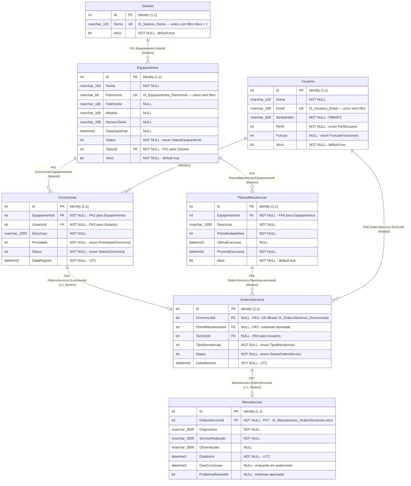
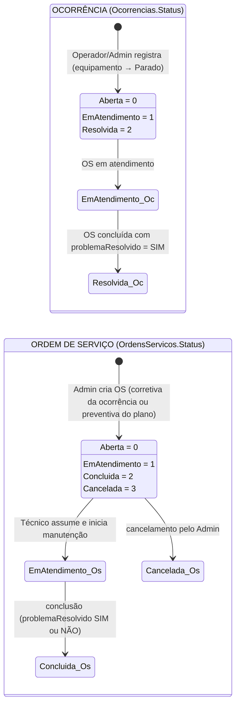

# DER — Modelo Físico do Banco de Dados (SQL Server)

**Projeto:** PIM — Sistema de Manutenção Industrial
**Banco oficial:** SQL Server (LocalDB em desenvolvimento), criado exclusivamente por EF Core Migrations
**Migration de origem do DDL:** `20261020021711_InitialCreate` (aplicada via `MigrateAsync`)
**Data deste documento:** 23/10/2026
**Escopo:** 7 tabelas, 8 chaves estrangeiras (todas `DeleteBehavior.Restrict`), 6 índices únicos (3 deles filtrados), 5 índices convencionais de FK e 1 CHECK constraint recém-aprovada.

> **Regra de ouro:** o banco EF Core é a base oficial do PIM. React e Flutter **nunca** acessam o SQL Server diretamente — somente via API (ver `docs/GUIA_BANCO_INTEGRACAO.md`).

---

## 1. Diagrama Entidade-Relacionamento físico

Tipos exibidos são os tipos SQL Server reais da `InitialCreate` (`nvarchar(N)`, `int`, `bit`, `datetime2`). Marcadores: **PK** = chave primária (identidade `1,1`), **FK** = chave estrangeira, **UK** = índice único.



> **Nota de leitura:** os dois relacionamentos **1:1** (`Ocorrencias ↔ OrdensServicos` e `OrdensServicos ↔ Manutencoes`) são modelados como `||--o|` (um para zero-ou-um): o lado dependente pode não existir ainda (ocorrência sem OS; OS sem manutenção), mas **nunca** pode existir mais de um. A unicidade é garantida por índice único: `IX_OrdensServicos_OcorrenciaId` (filtrado por `[OcorrenciaId] IS NOT NULL`) e `IX_Manutencoes_OrdemServicoId`.

---

## 2. As 8 chaves estrangeiras (todas com `ON DELETE RESTRICT` / `DeleteBehavior.Restrict`)

| # | Constraint SQL Server | Coluna filha | Tabela referenciada | Cardinalidade | Comportamento |
|---|---|---|---|---|---|
| 1 | `FK_Equipamentos_Setores_SetorId` | `Equipamentos.SetorId` (NOT NULL) | `Setores.Id` | 1 Setor : N Equipamentos | Restrict |
| 2 | `FK_Ocorrencias_Equipamentos_EquipamentoId` | `Ocorrencias.EquipamentoId` (NOT NULL) | `Equipamentos.Id` | 1 Equipamento : N Ocorrências | Restrict |
| 3 | `FK_Ocorrencias_Usuarios_UsuarioId` | `Ocorrencias.UsuarioId` (NOT NULL) | `Usuarios.Id` | 1 Usuário : N Ocorrências registradas | Restrict |
| 4 | `FK_OrdensServicos_Ocorrencias_OcorrenciaId` | `OrdensServicos.OcorrenciaId` (NULL) | `Ocorrencias.Id` | **1:1** Ocorrência : OS corretiva | Restrict |
| 5 | `FK_OrdensServicos_PlanosManutencao_PlanoManutencaoId` | `OrdensServicos.PlanoManutencaoId` (NULL) | `PlanosManutencao.Id` | 1 Plano : N OS preventivas | Restrict |
| 6 | `FK_OrdensServicos_Usuarios_TecnicoId` | `OrdensServicos.TecnicoId` (NULL) | `Usuarios.Id` | 1 Técnico : N OS atribuídas | Restrict |
| 7 | `FK_Manutencoes_OrdensServicos_OrdemServicoId` | `Manutencoes.OrdemServicoId` (NOT NULL) | `OrdensServicos.Id` | **1:1** OS : Manutenção | Restrict |
| 8 | `FK_PlanosManutencao_Equipamentos_EquipamentoId` | `PlanosManutencao.EquipamentoId` (NOT NULL) | `Equipamentos.Id` | 1 Equipamento : N Planos | Restrict |

---

## 3. Os 6 índices únicos (marcados no diagrama)

| Índice | Tabela | Coluna | Filtro | Efeito de negócio |
|---|---|---|---|---|
| `IX_Usuarios_Email` | Usuarios | Email | — (sem filtro) | E-mail é credencial de login: sem duplicidade absoluta |
| `IX_Equipamentos_Patrimonio` | Equipamentos | Patrimonio | — (sem filtro) | Patrimônio é identificador físico único |
| `IX_Setores_Nome` | Setores | Nome | `[Ativo] = 1` | Dois setores **ativos** não podem ter o mesmo nome; histórico inativo pode repetir nome |
| `IX_Ocorrencias_EquipamentoId` | Ocorrencias | EquipamentoId | `[Status] <> 2` (`StatusOcorrencia.Resolvida = 2`) | No máximo **uma ocorrência ativa** por equipamento, mesmo sob concorrência |
| `IX_OrdensServicos_OcorrenciaId` | OrdensServicos | OcorrenciaId | `[OcorrenciaId] IS NOT NULL` | Cada ocorrência gera **no máximo uma OS** (1:1 corretiva) |
| `IX_Manutencoes_OrdemServicoId` | Manutencoes | OrdemServicoId | — (sem filtro) | Cada OS tem **no máximo uma manutenção** registrada (1:1) |

Os demais 5 índices (`IX_Equipamentos_SetorId`, `IX_Ocorrencias_UsuarioId`, `IX_OrdensServicos_PlanoManutencaoId`, `IX_OrdensServicos_TecnicoId`, `IX_PlanosManutencao_EquipamentoId`) são índices **convencionais não únicos** criados automaticamente pelo EF Core para cada FK — aceleram joins e pesquisas por relação. A lista completa, com filtros, está no dicionário de dados.

---

## 4. CHECK constraint `CK_OrdensServicos_TipoOrigem` — ⭐ Implementação aprovada 2026-10-23

Nova restrição de integridade **aprovada e definida em 23/10/2026** para a tabela `OrdensServicos`. Garante **exatamente uma origem por OS**, coerente com `TipoManutencao`:

- **Corretiva** (`TipoManutencao = 0`): exige `OcorrenciaId NOT NULL` **e** `PlanoManutencaoId NULL`;
- **Preventiva** (`TipoManutencao = 1`): exige `PlanoManutencaoId NOT NULL` **e** `OcorrenciaId NULL`.

Definição SQL Server correspondente — já materializada na **migration incremental** `20261023061811_OrdemServicoTipoOrigemCheck` (a `InitialCreate` permanece intocada):

```sql
ALTER TABLE [OrdensServicos] ADD CONSTRAINT [CK_OrdensServicos_TipoOrigem] CHECK (
    ([TipoManutencao] = 0 AND [OcorrenciaId] IS NOT NULL AND [PlanoManutencaoId] IS NULL)
    OR
    ([TipoManutencao] = 1 AND [PlanoManutencaoId] IS NOT NULL AND [OcorrenciaId] IS NULL)
);
```

A CHECK é **complementar** ao índice único filtrado `IX_OrdensServicos_OcorrenciaId`: a CHECK impede OS sem origem ou com as duas origens; o índice impede duas OS para a mesma ocorrência. Juntos, eles tornam impossível no banco uma OS "órfã" (sem origem) ou "híbrida" (com as duas origens).

> **Status de aplicação:** a migration incremental existe no repositório, mas **ainda não foi aplicada** no banco oficial `SistemaManutencaoPIM` — o `__EFMigrationsHistory` oficial contém apenas a `InitialCreate`. A aplicação deliberada (`dotnet ef database update`) e a validação no SQL Server do grupo seguem o fluxo de `docs/GUIA_BANCO_INTEGRACAO.md` (seções 8.2 e 8.3).

---

## 5. Comportamento das chaves estrangeiras (`Restrict`)

Todas as 8 FKs usam `DeleteBehavior.Restrict` (`ON DELETE NO ACTION` no SQL Server). Consequências práticas:

1. **Nenhum registro pai é excluído enquanto existir filho** que o referencie — o SQL Server rejeita o `DELETE` com erro de integridade referencial (a API traduz `DbUpdateException` em HTTP 409).
2. Não há exclusão em cascata em nenhuma parte do modelo: **não existe** "apagar equipamento e perder ocorrências/OS/manutenções".
3. O ciclo `Setores → Equipamentos → Ocorrencias/PlanosManutencao → OrdensServicos → Manutencoes` é protegido dos dois lados: a desativação correta é via flag `Ativo = 0` (soft delete lógico), não via `DELETE` físico.
4. O histórico de manutenção é tratado como registro permanente: a exclusão de uma OS exige primeiro a exclusão da manutenção vinculada, e mesmo assim não é um fluxo previsto pela API.

**Ordem de criação das tabelas na migration (respeitando as FKs):** `Setores` → `Usuarios` → `Equipamentos` → `Ocorrencias` → `PlanosManutencao` → `OrdensServicos` → `Manutencoes`. O `Down()` desfaz exatamente na ordem inversa.

---

## 6. Fluxo de estados (contexto visual secundário)

Diagrama simplificado, apenas para navegação visual dos status persistidos nas colunas `Status`. As regras oficiais de transição estão na API (services) e no README; este diagrama **não** é implementado no banco (os status são `int` convencionais, sem CHECK de transição).



Complementos de comportamento (ver README e `docs/PENDENCIAS_E_DECISOES.md`): conclusão com `problemaResolvido = NÃO` devolve a ocorrência para `Aberta` e mantém o equipamento `Parado` (continuidade em decisão — pendência **D1**); OS preventiva não resolvida também deixa o equipamento `Parado` (pendência **D2**); registro de ocorrência por Administrador é permissão extra a ratificar (pendência **D11**).

---

## 7. Fontes

- `SistemaManutencao.API/Models/Entidades.cs` — 7 entidades.
- `SistemaManutencao.API/Data/AppDbContext.cs` — mapeamento, índices, `DeleteBehavior.Restrict`.
- `SistemaManutencao.API/Migrations/20261020021711_InitialCreate.cs` — DDL real (tipos, nulabilidade, índices).
- `SistemaManutencao.API/Migrations/AppDbContextModelSnapshot.cs` — snapshot vigente do modelo.
- `SistemaManutencao.API/Enums/Tipos.cs` — valores numéricos dos enums.
- `docs/PENDENCIAS_E_DECISOES.md` — pendências D1/D2/D11 (permanecem abertas, não resolvidas por este documento).

Documentos complementares: `docs/DICIONARIO_DADOS.md` (coluna a coluna) e `docs/GUIA_BANCO_INTEGRACAO.md` (migrations, ambientes e integração).
